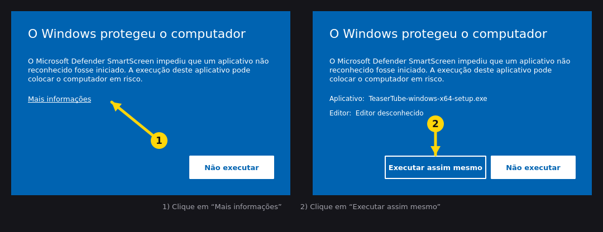

## TeaserTube

Baixe vídeos e playlists do YouTube em **MP4** ou só o áudio em **MP3**, com uma interface simples: cole o link, escolha o formato e clique em Baixar.

### Qual arquivo baixar

| Seu sistema | Arquivo | Como instalar |
|-------------|---------|---------------|
| Windows 10 ou 11 (64 bits) | `TeaserTube-windows-x64-setup.exe` | Dois cliques e siga o instalador (não precisa de administrador) |
| Mac com chip Apple (M1, M2, M3...) | `TeaserTube-macos-apple-silicon.dmg` | Abra e arraste o TeaserTube para *Aplicativos* |
| Mac com processador Intel | `TeaserTube-macos-intel.dmg` | Abra e arraste o TeaserTube para *Aplicativos* |
| Linux 64 bits (Intel/AMD) | `TeaserTube-linux-x64.tar.gz` | Extraia e execute `TeaserTube/TeaserTube` |
| Linux ARM64 (Raspberry Pi 4/5...) | `TeaserTube-linux-arm64.tar.gz` | Extraia e execute `TeaserTube/TeaserTube` |

Não sabe qual Mac você tem? Menu  > *Sobre este Mac*: se aparecer "Chip Apple", é o de Apple Silicon.
Os arquivos **Source code (zip / tar.gz)** no fim da página são só o código-fonte; não precisa deles para usar o app.

### O sistema mostrou um aviso de segurança?

- **Windows (tela azul "O Windows protegeu o computador"):** é o SmartScreen, que aparece em qualquer programa novo ainda sem assinatura digital. Dois cliques resolvem, só na primeira vez:

  

- **macOS:** clique com o botão direito no app e escolha **Abrir**. Só na primeira vez.
- O código é aberto e os arquivos são gerados automaticamente pelo GitHub Actions a partir deste repositório.

### Linux

Funciona nas distribuições de 2020 em diante (Ubuntu 20.04+, Debian 11+, Fedora, Arch, openSUSE, Linux Mint, Pop!_OS...). Se não abrir, instale a biblioteca gráfica que falta: `sudo apt install libxcb-cursor0` (Debian/Ubuntu) ou `sudo dnf install xcb-util-cursor` (Fedora).

**Outros sistemas** (Windows 7/8, sistemas 32 bits, BSD): o Qt atual não roda neles. Se você tem Python 3.9+, dá para usar pelo código; veja o README.

### O que ele faz

- Vídeo em MP4 (melhor qualidade, 1080p, 720p, 480p ou 360p) ou áudio em MP3
- Playlists: escolha quais vídeos baixar; cada playlist vai para a própria pasta
- Mostra qual vídeo falhou e por quê, e tenta de novo sozinho quando é falha passageira
- Não precisa instalar Python, ffmpeg nem mais nada

⭐ **Gostou?** [Deixe uma estrela no repositório](https://github.com/dutrathiagodev/TeaserTube), ajuda muito o projeto!

Dúvidas ou problemas? Abra uma [issue](https://github.com/dutrathiagodev/TeaserTube/issues).
