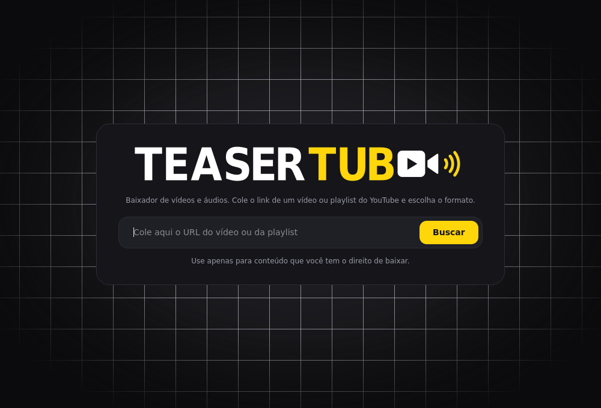
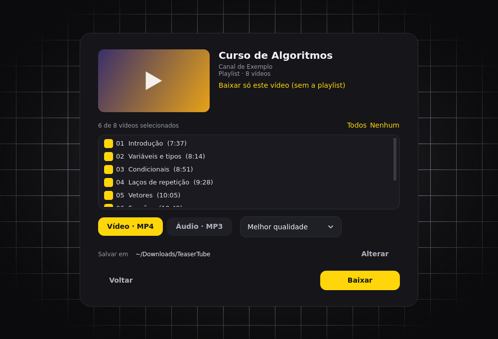
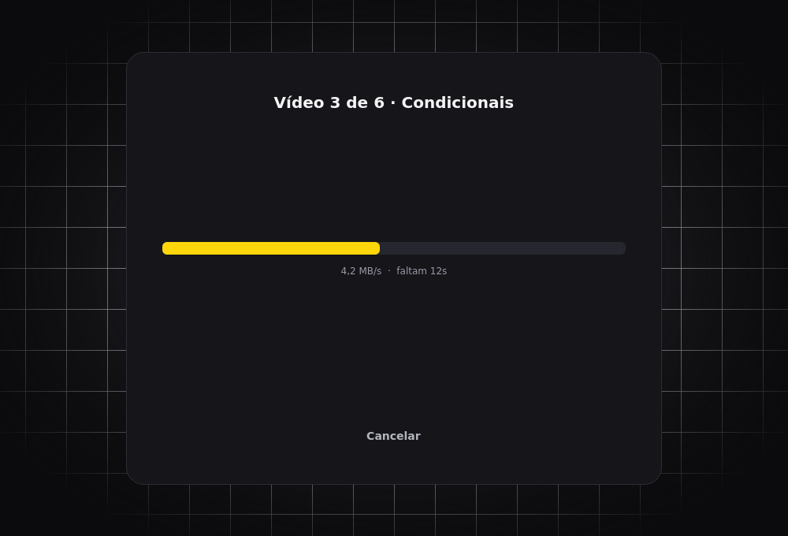

<h1 align="center">
   TeaserTube
</h1>

<p align="center">
  
  
  
  
</p>

<p align="center">
  <strong>Baixe vídeos e playlists do YouTube em MP4 ou MP3.</strong><br/>
  Cole o link, escolha o formato e pronto. Open source, sem anúncios e sem instalar mais nada.
</p>

<h3 align="center"><a href="../../releases"><ins>Baixar o app</ins></a></h3>

<p align="center">
  
</p>

## Recursos

<table>
<tr>
<td width="46%" valign="middle">

### Vídeo ou só o áudio

MP4 na melhor qualidade ou em 1080p, 720p, 480p e 360p. Prefere música? Baixe em MP3 a 192 kbps.

</td>
<td width="54%">
  
</td>
</tr>
<tr>
<td width="46%" valign="middle">

### Playlists do seu jeito

Marque só os vídeos que quiser. Cada playlist vai para a própria pasta, numerada na ordem certa. Colou um vídeo que está dentro de uma playlist? Um botão baixa só ele.

</td>
<td width="54%">
  
</td>
</tr>
</table>

- **Nada para instalar além do Python:** o ffmpeg e o runtime JS vêm junto, como pacotes pip.
- **Progresso e cancelar:** acompanhe a velocidade e o tempo restante.
- **Seus arquivos ficam à mão:** por padrão, na pasta `downloads/` do próprio app (dá para trocar).

## Como usar

Requer Python 3.9 ou mais novo (no Windows, marque "Add Python to PATH" ao instalar).
Baixe ou clone o repositório e dê **dois cliques** no launcher do seu sistema:

| Sistema | Arquivo |
|---------|---------|
| Windows | `TeaserTube.bat` |
| macOS   | `TeaserTube.app` |
| Linux   | `TeaserTube.sh` |

Na primeira vez ele prepara tudo (leva cerca de um minuto) e cria um atalho **TeaserTube**,
com o ícone, na sua área de trabalho. Depois é só abrir por ele.

<details>
<summary>Instalação manual e solução de problemas</summary>

```bash
python3 -m venv .venv
source .venv/bin/activate        # Windows: .venv\Scripts\activate
pip install -r requirements.txt
python -m teasertube
```

- Se mudar a pasta do projeto de lugar, recrie o atalho com `python -m teasertube.shortcut`.
- Linux: se o clique duplo no `.sh` abrir um editor, rode `./TeaserTube.sh` uma vez no terminal.
- Linux: erro do Qt `xcb` ao abrir? `sudo apt install libxcb-cursor0`.
- macOS: se o sistema bloquear o app na primeira vez, clique com o botão direito e escolha "Abrir".

</details>

<details>
<summary>Gerar o app com ícone (sem precisar de Python)</summary>

O workflow `.github/workflows/release.yml` gera o `.exe`, o `.app` e o binário Linux com o ícone.
Crie uma tag (`git tag v0.1.0 && git push --tags`) ou rode em *Actions > Release > Run workflow*;
os arquivos aparecem em *Releases*. Para empacotar na sua máquina:

```bash
pip install pyinstaller
pyinstaller --noconfirm --windowed --name TeaserTube --icon teasertube/assets/icon.png \
  --add-data "teasertube/assets:teasertube/assets" \
  --collect-all imageio_ffmpeg --collect-all deno --collect-all yt_dlp_ejs run_teasertube.py
```

No Windows, troque `:` por `;` em `--add-data` e use `--icon teasertube/assets/icon.ico`.

</details>

## Contribuir

Pull requests são bem-vindos. O código fica em `teasertube/` (`core.py` cuida dos downloads,
`gui.py` da interface). Os scripts em `tools/` regeneram o logo, os ícones e as imagens deste README.

## Aviso legal

Baixe apenas conteúdo que você tem direito de baixar e respeite os termos de uso das plataformas.
O autor não se responsabiliza pelo uso da ferramenta.

## Licença

[MIT](LICENSE)
